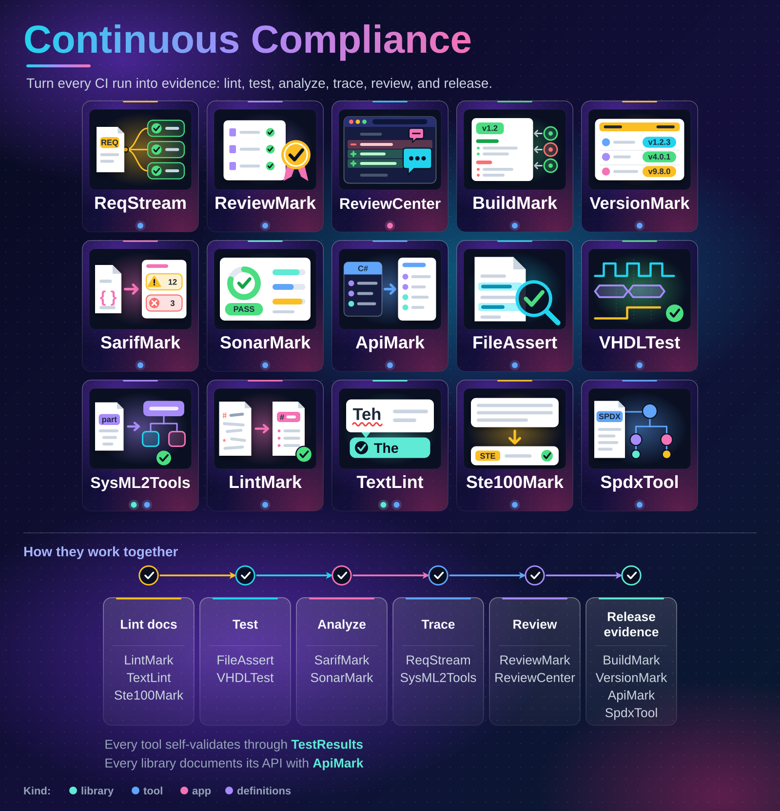
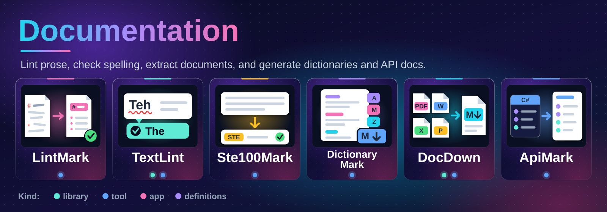
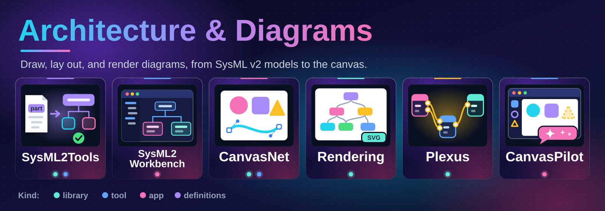
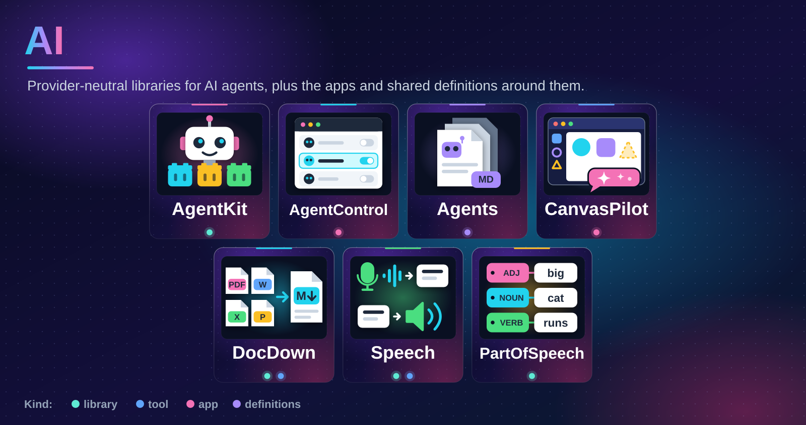
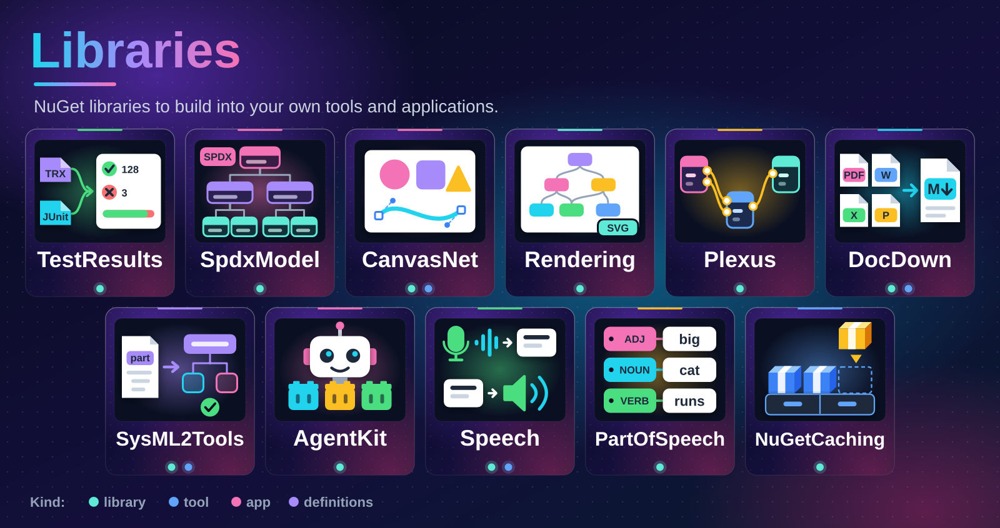
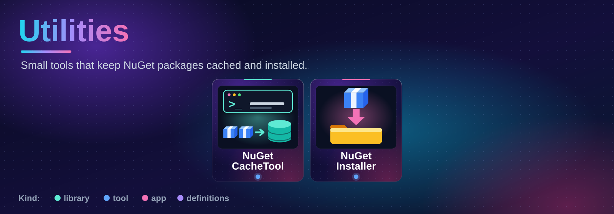

# ![Tool Families: Open .NET tool families for quality software][hero]

[hero]: https://raw.githubusercontent.com/demaconsulting/.github/main/docs/images/hero.png

DEMA Consulting builds open-source .NET tools, libraries, and applications that automate the quality and compliance
work around software development: build notes, review evidence, requirements tracking, quality reports, and diagrams.
Together they put our [Continuous Compliance](https://github.com/demaconsulting/ContinuousCompliance) approach into
practice, where every CI run produces evidence that the software meets its requirements. A project can belong to more
than one of the families below.

**Getting started:** begin a new project from
[TemplateDotNetTool](https://github.com/demaconsulting/TemplateDotNetTool) or
[TemplateDotNetLibrary](https://github.com/demaconsulting/TemplateDotNetLibrary), read the approach in
[ContinuousCompliance](https://github.com/demaconsulting/ContinuousCompliance), and share agent standards through
[Agents](https://github.com/demaconsulting/Agents).

---

<!-- Continuous Compliance -->

Software that is built to be trusted needs proof, and proof collected by hand at the end of a project is slow and easy
to get wrong. These tools collect it automatically during every CI run. They lint the documentation, run and verify
the tests, and analyze code quality, and [ReqStream](https://github.com/demaconsulting/ReqStream) traces requirements
to passing tests. [ReviewMark](https://github.com/demaconsulting/ReviewMark) assists with code and file reviews,
[BuildMark](https://github.com/demaconsulting/BuildMark) generates the build notes, and
[VersionMark](https://github.com/demaconsulting/VersionMark) records the tool versions a build used. Reach for them
when you must show, not just claim, that each release met its requirements.

---

<!-- Documentation -->

Documentation drifts when nothing checks it. These tools check and generate the text around your code.
[LintMark](https://github.com/demaconsulting/LintMark), [TextLint](https://github.com/demaconsulting/TextLint), and
[Ste100Mark](https://github.com/demaconsulting/Ste100Mark) lint Markdown for style, spelling, and Simplified Technical
English. [DictionaryMark](https://github.com/demaconsulting/DictionaryMark) builds Markdown dictionaries from other
formats, [DocDown](https://github.com/demaconsulting/DocDown) extracts PDF and Office documents to Markdown, and
[ApiMark](https://github.com/demaconsulting/ApiMark) generates compact API references. Reach for them when
documentation must stay correct as the code changes.

---

<!-- Architecture & Diagrams -->

Diagrams drawn by hand go stale as the design changes. These projects keep the architecture in a model and draw the
pictures from it. [SysML2Tools](https://github.com/demaconsulting/SysML2Tools) parses, lints, and renders SysML v2
models, and [SysML2Workbench](https://github.com/demaconsulting/SysML2Workbench) is a desktop viewer and IDE for them.
[Rendering](https://github.com/demaconsulting/Rendering), [CanvasNet](https://github.com/demaconsulting/CanvasNet), and
[Plexus](https://github.com/demaconsulting/Plexus) are the layout, drawing, and block-diagram libraries underneath, and
[CanvasPilot](https://github.com/demaconsulting/CanvasPilot) is an AI-assisted drawing app. Reach for them when you
want diagrams generated from models instead of drawn by hand.

---

<!-- AI -->

AI agents need tools they can trust and instructions they can share.
[AgentKit](https://github.com/demaconsulting/AgentKit)
provides provider-neutral libraries for developing agents, with [DocDown](https://github.com/demaconsulting/DocDown),
[Speech](https://github.com/demaconsulting/Speech), and [PartOfSpeech](https://github.com/demaconsulting/PartOfSpeech)
supplying document, speech, and language processing.
[AgentControl](https://github.com/demaconsulting/AgentControl) launches agents with proprietary configuration kept out
of source control, and [Agents](https://github.com/demaconsulting/Agents) holds the agent definitions and coding
standards shared across DEMA repositories. Reach for them when you are building an agent or standardizing how agents
work in your repositories.

---

<!-- Libraries -->

These NuGet libraries are the building blocks behind many of the tools above, and you can use them in your own
software. They read and write test results
([TestResults](https://github.com/demaconsulting/TestResults)) and SPDX models
([SpdxModel](https://github.com/demaconsulting/SpdxModel)), draw and lay out diagrams
([CanvasNet](https://github.com/demaconsulting/CanvasNet), [Rendering](https://github.com/demaconsulting/Rendering),
[Plexus](https://github.com/demaconsulting/Plexus)), and extract documents
([DocDown](https://github.com/demaconsulting/DocDown)). Reach for them when you need one of these functions inside your
own application. A card with two dots shows a project that also ships as a dotnet tool.

---

<!-- Utilities -->

Builds that depend on NuGet packages are only as repeatable as their package sources.
[NuGetCacheTool](https://github.com/demaconsulting/NuGetCacheTool) caches NuGet packages on the local system, and
[NuGetInstaller](https://github.com/demaconsulting/NuGetInstaller) installs the packages listed in a file, similar to
`nuget install`. Reach for them when a build needs its packages cached and installed predictably.

---

## Getting Help

Open an issue in the relevant repository. Please report security vulnerabilities privately through
the repository's **Security** tab.

Browse the [full list of repositories](https://github.com/orgs/demaconsulting/repositories) for more.
