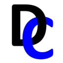

# DEMA Consulting

Software engineering tools and libraries focused on quality, documentation, and requirements
traceability.

## What We Do

We build .NET tools and libraries that automate the quality and compliance work around software
development, such as build notes, review evidence, requirements tracking, and reporting.

## Featured Projects

- [ReqStream](https://github.com/demaconsulting/ReqStream) - Requirements management tool
- [ReviewMark](https://github.com/demaconsulting/ReviewMark) - Assists with code and file reviews
- [BuildMark](https://github.com/demaconsulting/BuildMark) - Generates Markdown build notes
- [SysML2Tools](https://github.com/demaconsulting/SysML2Tools) - SysML v2 parsing, linting, and diagram rendering

Browse the [full list of repositories](https://github.com/orgs/demaconsulting/repositories) for
more.

## Starting a New Project

- [TemplateDotNetLibrary](https://github.com/demaconsulting/TemplateDotNetLibrary)
- [TemplateDotNetTool](https://github.com/demaconsulting/TemplateDotNetTool)

## Getting Help

Open an issue in the relevant repository. Please report security vulnerabilities privately through
the repository's **Security** tab.
